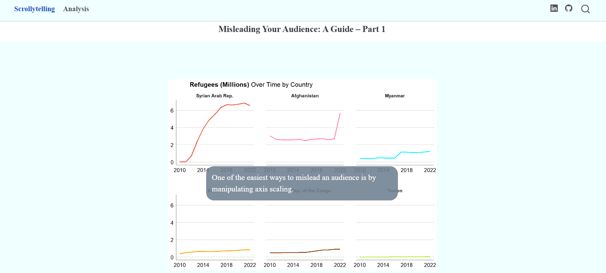

## Scrollytelling Project: Misleading Your Audience: A Guide – Part 1

### View [Scrollytelling Project](https://connect.posit.cloud/darakhshannehal/content/01a1b77a-10ec-c5ab-c42d-e4b2f6faed11?utm_source=rsconnect-rstudio)



Built with **Quarto**, **Closeread** extension, and **R**, this project serves as an educational example of how visual choices in data presentation can significantly influence the audience's perception and understanding of the underlying information. It specifically focuses on the impact of **y-axis scaling** in **time-series** visualizations.

### R packages used:
- **refugees**: UNHCR refugee data via the **#TidyTuesday** 
- **tidyverse**: Data wrangling, transformation, and plotting (dplyr, ggplot2, etc.)
- **ggplot2**:	Core plotting library for time-series and facet charts
- **patchwork**:	Combines multiple ggplot objects into side-by-side layouts
- **grid**:	Controls plot spacing and margins using unit()
- **ggtext**:	Enables Markdown/HTML formatting in plot titles and axis labels

### Data: UNHCR's refugees R package


### Closeread setup: 
#### To add Closeread to your own Quarto project:
```
quarto add qmd-lab/closeread
```
